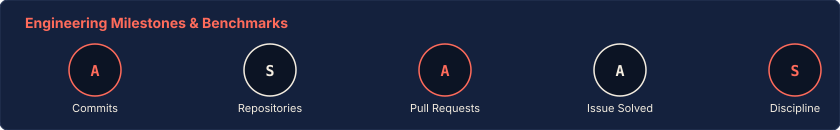
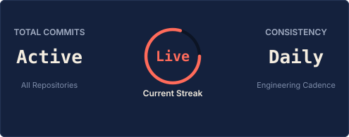

  <strong>
    [LinkedIn]() &nbsp;•&nbsp;
    [GitHub](https://github.com/jitendrabeep) &nbsp;•&nbsp;
    [Codeforces]() &nbsp;•&nbsp;
    [CodeChef]() &nbsp;•&nbsp;
    [LeetCode]() &nbsp;•&nbsp;
    [Portfolio]() &nbsp;•&nbsp;
    [Resume]() &nbsp;•&nbsp;
    [Email]()
  </strong>

---

### About

Software engineer focused on systems programming, algorithmic problem-solving, and scalable full-stack applications. I approach software from first principles: low-level execution speed in C/C++, sound data structure foundations, and shipping maintainable, purposeful code.

- **Engineering Mindset:** *"Learn, build, compete, and get better — one project and one problem at a time."*
- **Primary Disciplines:** C/C++ Systems, Competitive Programming (DSA), Full-Stack Architecture, and Applied AI/ML.

---

### Competitive Programming

| Platform | Division / Tier | Rating Benchmark | Verification |
| :--- | :--- | :---: | :---: |
|  | **Candidate Master** | `[rating]` | [Profile]() |
|  | **5-Star (★★★★★)** | `[rating]` | [Profile]() |
|  | **Knight** | `[rating]` | [Profile]() |

> Dedicated to algorithmic rigour, execution speed, and proofs across competitive rounds.

---

### Technical Arsenal

| Domain | Technologies & Competencies |
| :--- | :--- |
| **Languages** |     |
| **Core CS** |       |
| **AI & ML** *(exploring)* |      |
| **Web Dev** *(learning)* |      |
| **Blockchain** *(exploring)* |      |
| **Tools** *(learning)* |       |

---

### Featured Projects

| Project | Description | Primary Stack | Lifecycle |
| :--- | :--- | :--- | :---: |
| **AI-Powered Study Assistant** | RAG-based knowledge system supporting document ingestion, semantic Q&A, and concept mastery tracking. | `Python` `FastAPI` `React` `PostgreSQL` `pgvector` | `In Planning` |
| **CP Analytics Platform** | Performance analytics system analyzing contest ratings and diagnosing topic-specific algorithmic weaknesses. | `C++` `Python` `React` `FastAPI` `Codeforces API` | `In Planning` |
| **Stock Exchange Simulator** | High-performance C++ matching engine modeling price-time priority order execution and latency benchmarking. | `C++17/20` `STL` `Multithreading` `Python` | `In Planning` |
| **Decentralized Governance** | Web3 governance decentralized application for transparent proposal lifecycles and verifiable on-chain voting. | `Solidity` `Ethereum` `Hardhat` `Ethers.js` `React` | `In Planning` |
| **ML Fraud Detection** | Real-time financial anomaly detection engine identifying fraud patterns and streaming risk probabilities. | `Python` `Pandas` `Scikit-learn` `XGBoost` `FastAPI` | `In Planning` |

---

### GitHub Activity & Analytics

  

  
  

  

  

---

### Contribution Grid

  <picture>
    <source media="(prefers-color-scheme: dark)" srcset="./assets/github-contribution-grid-snake-dark.svg">
    <source media="(prefers-color-scheme: light)" srcset="./assets/github-contribution-grid-snake.svg">
    
  </picture>

---

### Connect

I am always interested in discussing algorithmic problem solving, low-level systems architectures, and high-impact engineering projects.

- **LinkedIn:** [LinkedIn]()
- **GitHub:** [GitHub](https://github.com/jitendrabeep)
- **Codeforces:** [Codeforces]()
- **CodeChef:** [CodeChef]()
- **LeetCode:** [LeetCode]()
- **Portfolio:** [Portfolio]()
- **Resume:** [Resume]()
- **Email:** [Email]()

---

  <em>"Engineering excellence isn't an accident — it's the quiet compounding of deep problem solving, clean architectures, and relentless consistency."</em>

